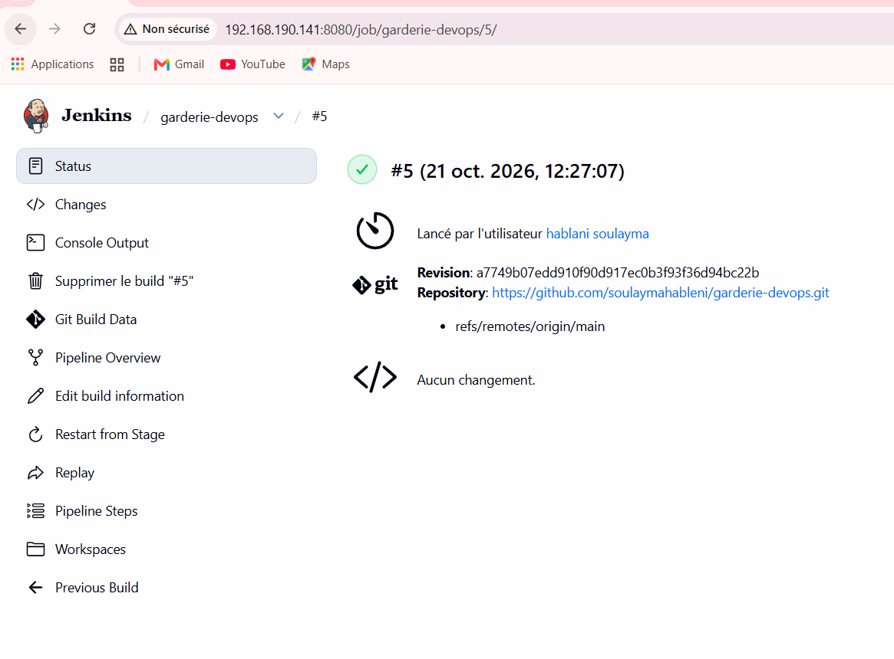
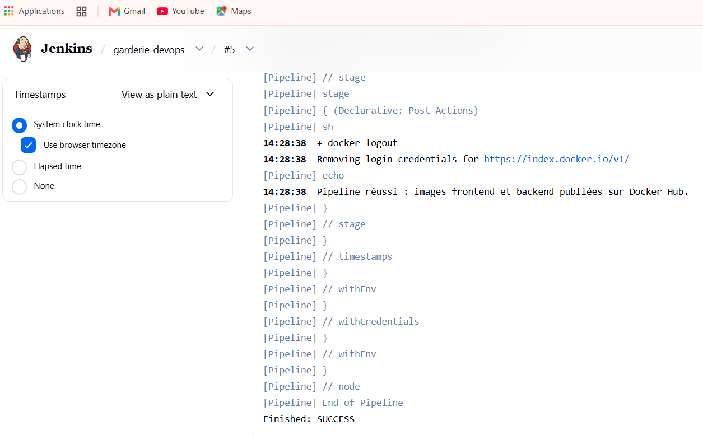
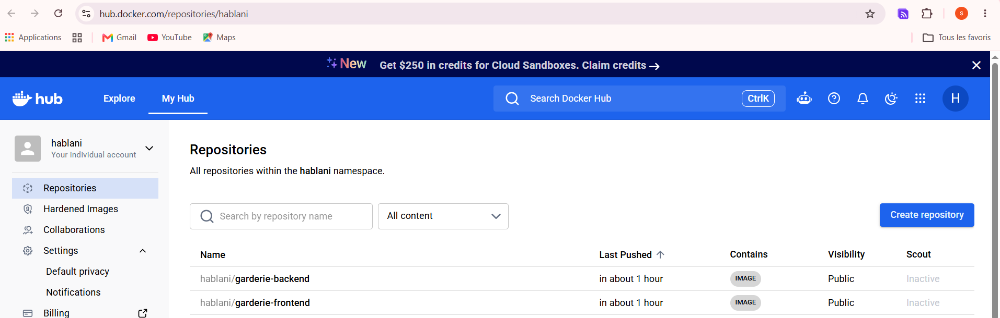
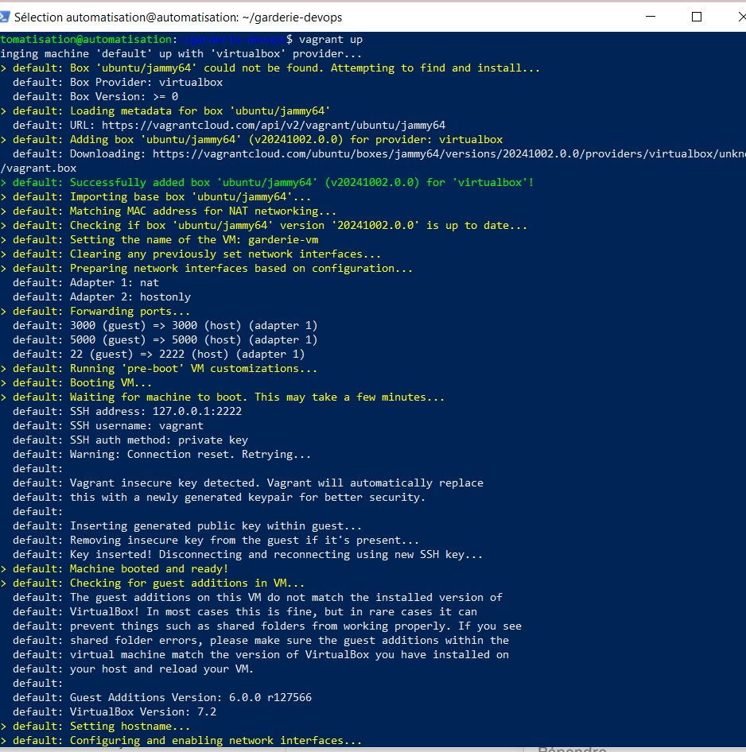
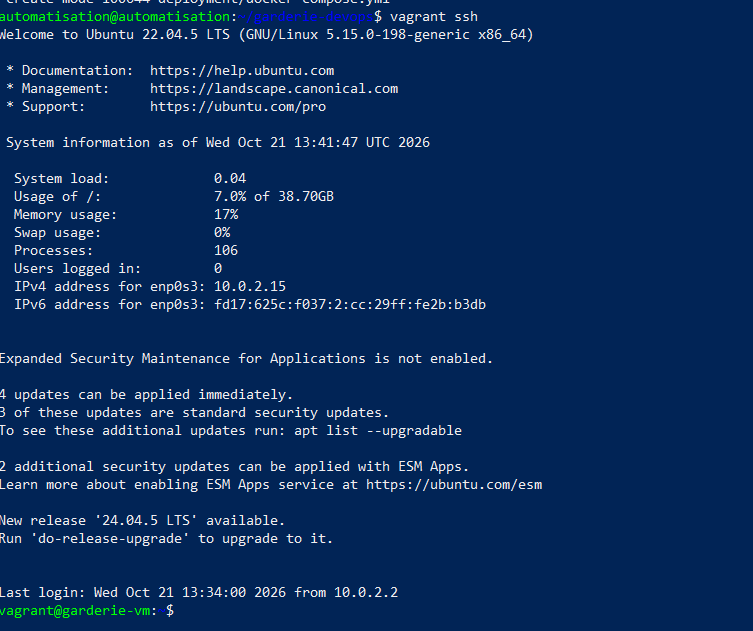
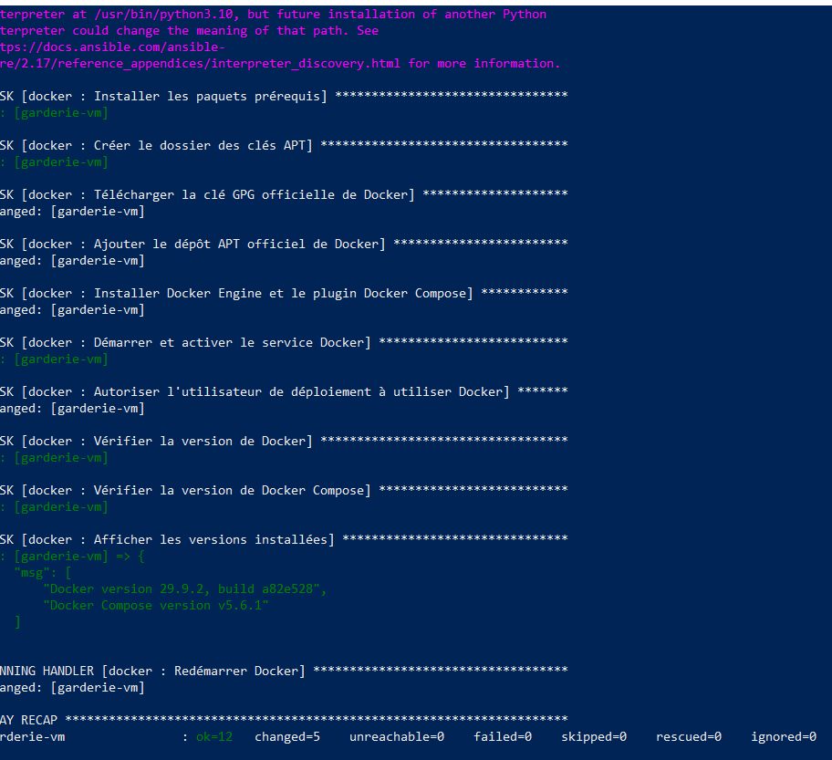
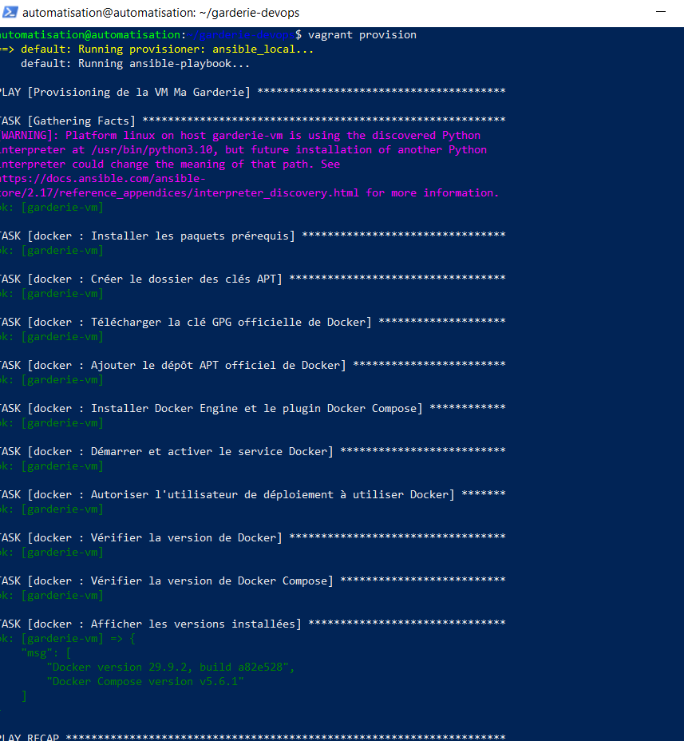
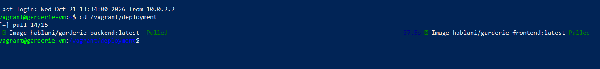
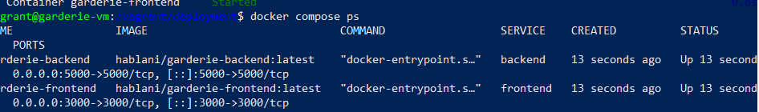
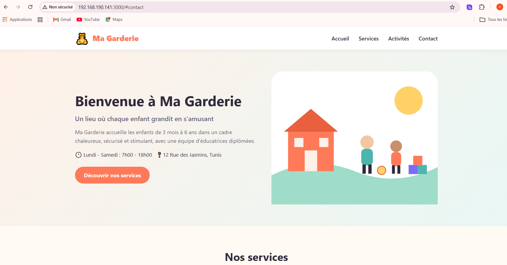

# 🧸 Ma Garderie — Chaîne CI/CD Jenkins, Docker, Vagrant & Ansible

Projet de l'épreuve pratique **Master DevOps & Cloud** : une landing page de garderie (Next.js) alimentée par une API REST (Express), construite et publiée par **Jenkins** sur **Docker Hub**, puis déployée avec **Docker Compose** dans une VM **Vagrant** provisionnée par **Ansible**.

---

## 1. Présentation et technologies

| Couche | Technologie |
|---|---|
| Frontend | Next.js 14 (React 18), CSS responsive |
| Backend | Node.js 20, Express 4 |
| Tests | Jest + React Testing Library |
| Conteneurs | Docker, Docker Compose |
| CI/CD | Jenkins (Pipeline as Code — `Jenkinsfile`) |
| Registre | Docker Hub |
| VM | Vagrant + VirtualBox (Ubuntu Server 22.04) |
| Provisioning | Ansible (rôle `docker`) |

**Frontend** : 3 composants — `Navbar` (logo, nom, menu), `Hero` (image, titre, description), `Services` (cartes des services) + une section Activités.
**Backend** : 3 API REST :

| Méthode | Route | Description |
|---|---|---|
| GET | `/api/garderie` | Informations générales |
| GET | `/api/services` | Liste des services |
| GET | `/api/activites` | Liste des activités |

---

## 2. Architecture

```
garderie-devops/
├── backend/                 # API Express + Dockerfile
├── frontend/                # Next.js + test Jest + Dockerfile
├── docker-compose.yml       # Compose de développement (build local)
├── Jenkinsfile              # Pipeline CI/CD
├── jenkins/                 # (optionnel) Jenkins prêt à l'emploi en conteneur
├── Vagrantfile              # VM Ubuntu 2 Go / 2 vCPU / 192.168.56.10
├── ansible/
│   ├── inventory.ini
│   ├── site.yml
│   └── roles/docker/        # Installation Docker Engine + Compose
├── deployment/
│   └── docker-compose.yml   # Déploiement à partir des images Docker Hub
└── screenshots/
```

### Chaîne CI/CD

```
GitHub ──► Jenkins : Checkout ► Install ► Test ► Build Front ► Build Back ► Push Front ► Push Back
                                           │ (échec = arrêt)                       │
                                                                                   ▼
                                                                              Docker Hub
                                                                                   │ docker compose pull
                                                                                   ▼
              Vagrant VM (Ubuntu) ◄── Ansible (rôle docker) ── Docker Compose : frontend:3000 ⇄ backend:5000
```

Le frontend récupère les données **côté serveur** (`getServerSideProps`) via le réseau Docker `garderie-net` à l'adresse `http://backend:5000` (variable `BACKEND_URL`).

---

## 3. Lancement local avec Docker Compose

```bash
docker compose up -d --build
```
- Application : http://localhost:3000
- API : http://localhost:5000/api/garderie

---

## 4. Pipeline Jenkins

1. Démarrer Jenkins (optionnel, image fournie avec Node.js + Docker CLI) :
   ```bash
   cd jenkins && docker compose up -d --build
   docker exec jenkins cat /var/jenkins_home/secrets/initialAdminPassword
   ```
2. Ouvrir http://localhost:8080 (port configurable dans `jenkins/docker-compose.yml`), installer les plugins suggérés.
3. **Manage Jenkins → Credentials → Global → Add Credentials** :
   - Kind : *Username with password*
   - Username : identifiant Docker Hub — Password : *Access Token* Docker Hub
   - **ID : `dockerhub-credentials`**
4. **New Item → Pipeline** → *Pipeline script from SCM* → Git → URL du dépôt → branche `*/main` → Script Path : `Jenkinsfile`.
5. **Build Now**.

Étapes : `Checkout → Install → Test → Build Frontend → Build Backend → Push Frontend → Push Backend`.
Si le test échoue, le pipeline s'arrête et aucune image n'est publiée.

### Images Docker Hub
- Frontend : https://hub.docker.com/r/hablani/garderie-frontend
- Backend : https://hub.docker.com/r/hablani/garderie-backend


---

## 5. Création et provisioning de la VM

Prérequis : VirtualBox + Vagrant.

```bash
vagrant up          # crée la VM et exécute automatiquement le playbook Ansible
vagrant ssh         # accès SSH
docker --version && docker compose version
```

- Box : `ubuntu/jammy64` — RAM 2 Go — 2 vCPU — IP privée `192.168.56.10`
- Provisioner `ansible_local` : Ansible est installé dans la VM et exécute `ansible/site.yml` (rôle `docker`).
- Relancer uniquement le provisioning : `vagrant provision`

Le rôle `docker` : installe Docker Engine, le plugin Docker Compose, démarre/active le service et ajoute l'utilisateur `vagrant` au groupe `docker`.

---

## 6. Déploiement avec Docker Compose (images Docker Hub)

```bash
vagrant ssh
cd /vagrant/deployment
cp .env.example .env && nano .env        # DOCKERHUB_USER=hablani
docker compose pull
docker compose up -d                     # aucun build local
docker compose ps
curl http://localhost:5000/api/garderie
curl http://localhost:5000/api/services
curl http://localhost:5000/api/activites
```

---

## 7. Accès à l'application

| Depuis | Adresse |
|---|---|
| Machine hôte Linux | http://192.168.56.10:3000 ou http://localhost:3000 |
| Autre machine du réseau (PC Windows) | **http://192.168.190.141:3000** |
| API (exemple) | http://192.168.190.141:5000/api/services |

> `192.168.190.141` est l'adresse IP de la machine hôte. Vagrant redirige les ports 3000 et 5000 de la VM vers cette machine (`forwarded_port`), ce qui rend l'application accessible depuis les autres postes du réseau.

## Dépôts
- GitHub : https://github.com/soulaymahableni/garderie-devops
- Docker Hub frontend : https://hub.docker.com/r/hablani/garderie-frontend
- Docker Hub backend : https://hub.docker.com/r/hablani/garderie-backend

---

## 8. Captures d'écran

### 1. Pipeline Jenkins exécuté avec succès



### 2. Images publiées sur Docker Hub


### 3. VM démarrée avec Vagrant



### 4. Exécution réussie du playbook Ansible



### 5. Conteneurs Docker en cours d'exécution (images Docker Hub)



### 6. Application accessible depuis une autre machine

